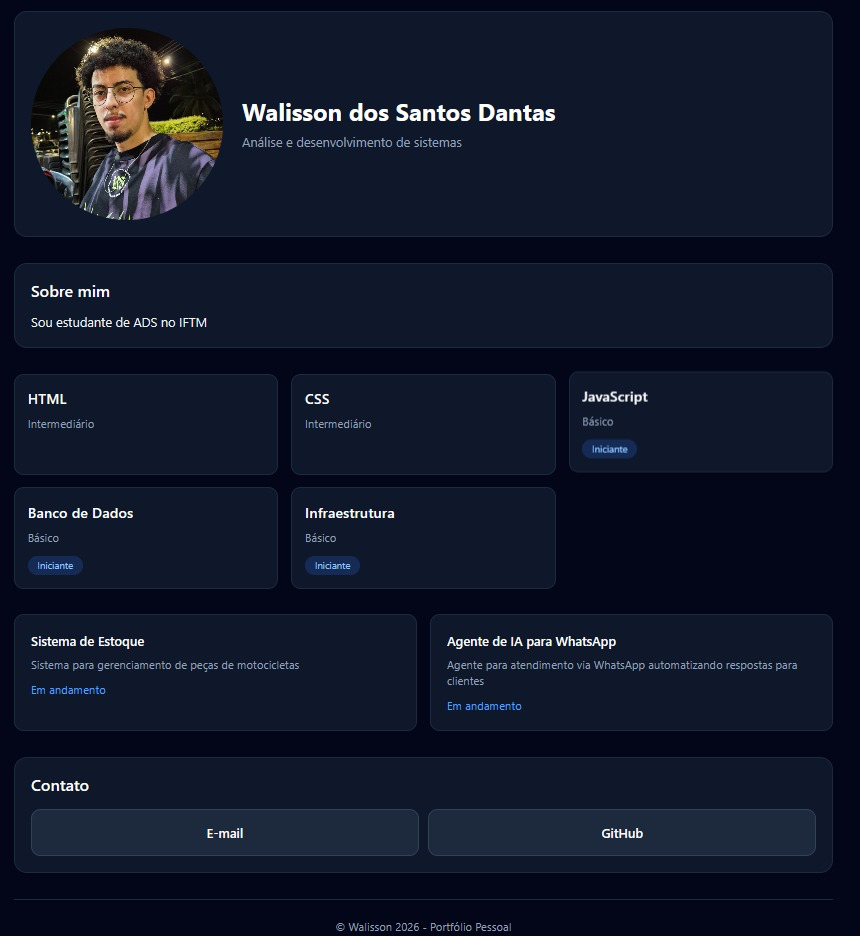

# Meu Portfólio em React

Desenvolvido por Walisson atualmente cursando Análise e Desenvolvimento de Sistemas.
Trabalhando na área como QA (Quality Assurance).

## Captura de tela



## Como executar

Ter Node.js e npm.

No terminal da pasta do projeto rode :

```
npm install
npm run dev
```

Abra o local host informado no terminal em seu navegador.

## Componentes do projeto

- **Cabecalho:** exibe minha foto, nome e curso.
- **Painel:** Sobre mim e utiliza children para receber conteúdo.
- **ListaHabilidades:** mostra minhas habilidades usando .map() e renderização com condição.
- **CardProjeto:** Mostra o nome, a descrição e o status de um projeto informados por props.
- **ListaProjetos:** percorre um array de projetos e gera os componentes CardProjeto.
- **Contato:** apresenta botões para enviar um e-mail e acessar o meu GitHub.
- **Rodape:** mostra o ano e os créditos do portfólio.

## Tecnologias usadas

O portfólio foi desenvolvido com Tailwind CSS, React e Typescript conforme as instruções  do slide. 
